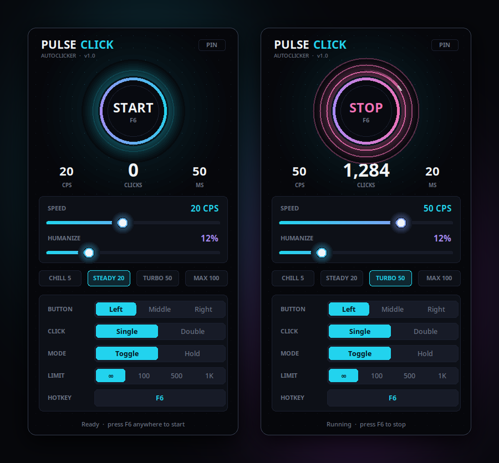

<div align="center">

# ⚡ PULSE CLICK

### A neon, glassy autoclicker. Fast, minimal, and fully rebindable.

*For games, testing, and anything repetitive.*

<br/>


[](LICENSE)

[**Quick Start**](#-quick-start) · [**Features**](#-features) · [**Build an .exe**](#-build-an-exe-windows) · [**Report a Bug**](https://github.com/akshar-g/PulseClick/issues)

<br/>



</div>

---

## ✦ Features

| | Feature | Details |
|---|---|---|
| 🎛️ | **Speed control** | Slider from 1 to 100 CPS, plus one-tap presets: **Chill**, **Steady**, **Turbo**, **Max** |
| 🎲 | **Humanize** | Adds random timing variation (0–50%) so clicks feel less robotic |
| 🖱️ | **Click types** | Left, Middle, or Right button, with Single or Double click |
| 🎯 | **Click limit** | Run forever, or stop automatically at 100, 500, or 1K clicks |
| 🔁 | **Toggle or Hold** | Press once to start and stop, or click only while the key is held |
| ⌨️ | **Global hotkey** | Default `F6`, fully rebindable, works while other apps are focused |
| ⏱️ | **Safe start** | 3-second countdown on the Start button gives you time to position the cursor |
| 📌 | **Pin on top** | Keep the window above everything else |
| 🔢 | **Live counter** | Watch your click count update in real time |
| 🌊 | **Neon UI** | Glassy dark interface with animated ripples that pulse on every click |

---

## ✦ Quick Start

```bash
# 1. Clone the repository
git clone https://github.com/akshar-g/PulseClick.git

# 2. Enter the project folder
cd PulseClick

# 3. Install dependencies
pip install -r requirements.txt

# 4. Run
python main.py
```

> **Requires Python 3.9+.** Tkinter ships with the standard Windows and macOS installers.

---

## ✦ Usage

1. **Set your speed.** Drag the slider or tap a preset.
2. **Fine-tune.** Adjust humanize, click limit, button, click type, and mode.
3. **Aim.** Place your cursor where you want to click.
4. **Go.** Press the hotkey, or hit **Start** for a 3-second head start.
5. **Stop.** Press the hotkey again. In **Hold** mode, clicking runs only while the key is held.

### Rebinding the hotkey

Click the hotkey box and press your new key. Press `Esc` to cancel.

---

## ✦ Build an .exe (Windows)

```bash
pip install pyinstaller
pyinstaller --onefile --noconsole --name PulseClick main.py
```

Your executable will be in the `dist/` folder.

---

## ✦ Notes

- ⚠️ **Windows speed cap:** Speeds above ~60 CPS may be limited by OS timer resolution.
- 🍎 **macOS permissions:** Grant **Accessibility** and **Input Monitoring** to your terminal or app.
- 🎮 **Games:** Some online games prohibit automation, and anti-cheat may flag it. Check a game's rules before using Pulse Click there.

---

## ✦ License

Distributed under the **MIT License**. See [LICENSE](LICENSE) for details.

---

<div align="center">

**PULSE CLICK ⚡**

*Click smarter, not harder.*

<br/>

⭐ If you find Pulse Click useful, consider giving it a star on [GitHub](https://github.com/akshar-g/PulseClick).

</div>
